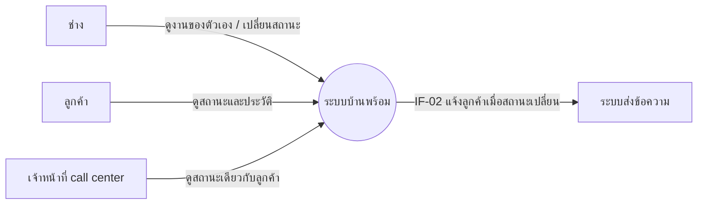
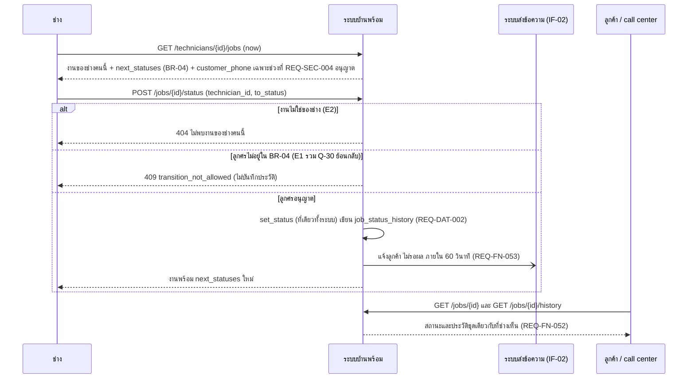

# โมเดลที่ UC-09 ใช้ (MD-CTX-09, MD-SEQ-09-03)

เวอร์ชัน 1.0 เข้า Baseline B2 ตาม CR-05 | เขียนด้วย Mermaid เปิดดูภาพได้บน GitHub
MD-DOM-01 (Job, JobStatusHistory, Customer, Technician) และ MD-STM-01 (8 สถานะ) ใช้ร่วมกับ SPEC-BOOKING อยู่ที่ specs/002-booking/models.md ไม่คัดลอกมา

## MD-CTX-09 Context Diagram (เฉพาะส่วนที่ UC-09 แตะ)

## MD-SEQ-09-03 ลำดับการเปลี่ยนสถานะโดยช่าง (UC-09 ขั้น 2 ถึง 5 รวม E1, E2)

