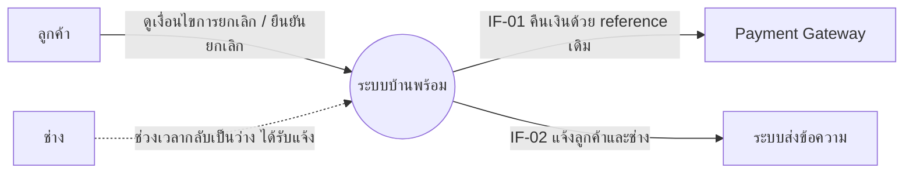
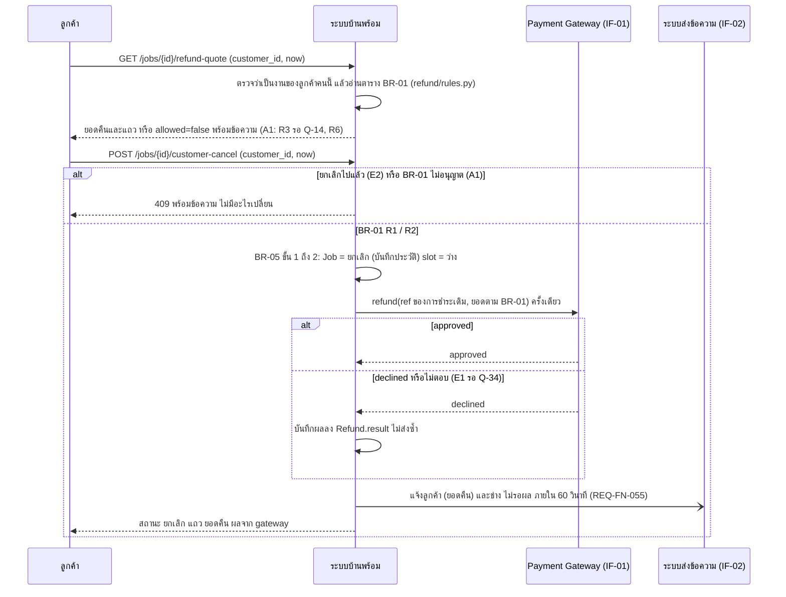

# โมเดลที่ UC-08 ใช้ (MD-CTX-08, MD-SEQ-08-05)

เวอร์ชัน 1.0 เข้า Baseline B2 ตาม CR-06 | เขียนด้วย Mermaid เปิดดูภาพได้บน GitHub
MD-DOM-01 (Job, TimeSlot, Payment, Refund) และ MD-STM-01 ใช้ร่วมกับ SPEC-BOOKING อยู่ที่ specs/002-booking/models.md ไม่คัดลอกมา
สิ่งที่ CR-06 เพิ่มใน MD-DOM-01 ระดับโค้ด: Refund มีฟิลด์ gatewayRef และ result (approved / declined / not_sent) ตัวแบบ conceptual ไม่เปลี่ยน

## MD-CTX-08 Context Diagram (เฉพาะส่วนที่ UC-08 แตะ)

## MD-SEQ-08-05 ลำดับการยกเลิกและคืนเงิน (UC-08 ขั้น 2 ถึง 6 รวม A1, E1, E2)

